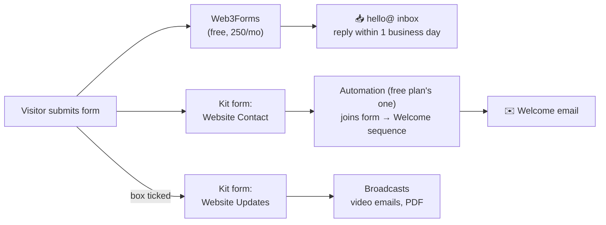

# Contact Loop — Setup, Copy & Test

**Goal:** every inquiry from staginggroundlabs.com is (1) emailed to `hello@` within seconds, (2) stored in Kit, (3) sent a welcome email, and (4) added to the updates list *only* if the visitor ticks the box.

**Why two Kit forms instead of tags:** Kit's public form endpoint reliably accepts a form ID; tag handling there is less predictable. "Joined the Website Updates form" becomes your opt-in audience. Simple and testable.

**Total cost:** $0. Kit Newsletter plan (free) includes one sequence and one basic automation, which is exactly what this uses.

---

## 1. Web3Forms (10 min)

1. Go to web3forms.com, enter `hello@staginggroundlabs.com`, and get your access key by email.
2. In `index.html`, replace `YOUR_WEB3FORMS_ACCESS_KEY` with it.
3. In Zoho, the first notification may land in spam. Mark it **Not spam** and add the sender to contacts.

The key is public by design (it can only send *to* your inbox). Safe to commit.

## 2. Kit (30–40 min)

| # | Step | Where in Kit |
|---|------|--------------|
| 1 | Sign up with `hello@staginggroundlabs.com` | kit.com |
| 2 | Add a **mailing address**. Kit requires one in every email footer. Use a PO box or virtual mailbox, **not your home address** | Settings → Account / Email |
| 3 | Authenticate the sending domain. Kit gives you DNS records; add them in **Porkbun**. If Kit asks you to change SPF, **edit** the one existing record (e.g. `v=spf1 include:zohomail.com include:<kit value> ~all`). Never add a second SPF record | Settings → Email → Sending domain |
| 4 | Create custom fields with these exact keys: `company`, `role`, `interest` | Subscribers → (any subscriber) → Add custom field |
| 5 | Create form **Website Contact** (inline, any template; you'll never show it). Turn **off** "Send incentive email" | Grow → Landing Pages & Forms → New → Form |
| 6 | Create form **Website Updates** the same way. Incentive email **off** (the checkbox is the consent) | Same |
| 7 | Copy each form's numeric ID from its edit URL (`.../forms/1234567/edit`) into `index.html`: `data-kit-contact-form` and `data-kit-updates-form` | — |
| 8 | Create a sequence **Welcome** with one email (copy below) | Send → Sequences |
| 9 | Create the automation: **Joins a form → Website Contact → Add to sequence → Welcome**. Publish it | Automate → Visual Automations |

### ⚠️ The one rule for broadcasts

Every broadcast's recipients = **"Subscribed to Website Updates."** Never "All subscribers." Contact-only people asked for a reply, not a newsletter.

---

## 3. Welcome email copy

**Subject:** Got your message. Here's what happens next.
**Preview text:** I'll reply personally within one business day.

> Hi {{ subscriber.first_name | default: "there" }},
>
> Thanks for reaching out to Staging Ground. Your message landed, and I'll reply personally within one business day.
>
> If you're exploring training for your team, three things help me come back with something useful:
>
> 1. What your stack looks like today (and what you're moving toward)
> 2. Roughly how many engineers, and where they're starting from
> 3. What isn't working right now
>
> Just hit reply.
>
> While you wait, here's how I think about engineering problems: **a ticket is a symptom of a system.** The first video on that idea goes up on the Staging Ground channel on November 16:
> https://www.youtube.com/@StagingGround
>
> Talk soon,
> Dwayne Pugh
> Founder, Staging Ground
> staginggroundlabs.com

**After Nov 16:** swap the channel link for the direct link to Video 1 ("A Ticket Is a Symptom of a System").
**When the PDF is ready:** add one line with the "6 Mental Models of Modernization" download.

---

## 4. Test the full loop (15 min, before announcing the site)

Use a personal Gmail as the "visitor."

| # | Test | Expect |
|---|------|--------|
| 1 | Submit with the box **unchecked** | Success message on page; alert in `hello@`; contact in Kit under *Website Contact* with company/role/interest filled; welcome email in Gmail **inbox** (not spam) |
| 2 | Submit again with a different Gmail alias (`you+test2@gmail.com`) with the box **checked** | Same as above, **plus** the contact appears under *Website Updates* |
| 3 | Leave name empty and submit | Inline error, nothing sent |
| 4 | Gmail → open the welcome email → **Show original** | SPF, DKIM, DMARC all **PASS** |
| 5 | Delete the test subscribers in Kit | Clean list |

## 5. If something doesn't work

| Symptom | Fix |
|---------|-----|
| Page says "The form isn't connected yet" | The Web3Forms key still has the `YOUR_` placeholder |
| Alert arrives, but nothing in Kit | In `index.html`, change `data-kit-base` to `https://app.convertkit.com` and retest. Still nothing? Use Kit's own embedded form for the opt-in only, and add contacts to Kit by hand from the inbox alert until we add a small serverless function |
| Contact in Kit, no welcome email | The automation isn't **published**, or the incentive email setting is still on |
| Custom fields blank in Kit | Field keys must be exactly `company`, `role`, `interest` (lowercase) |
| Welcome email lands in spam | Domain authentication in Kit isn't finished, or SPF has two records |
| Spam submissions | The honeypot catches most bots. If spam gets through, turn on Web3Forms' free hCaptcha |
